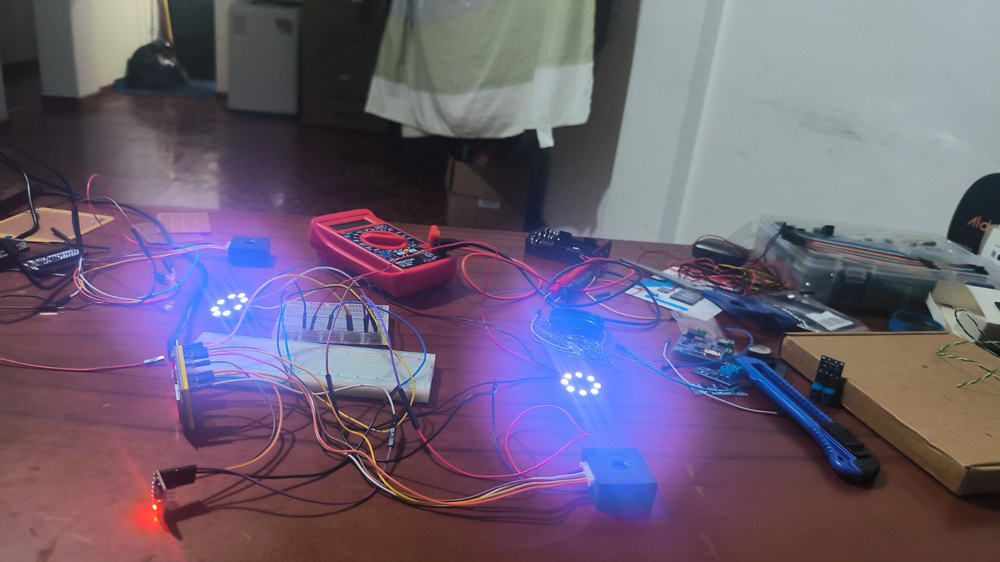
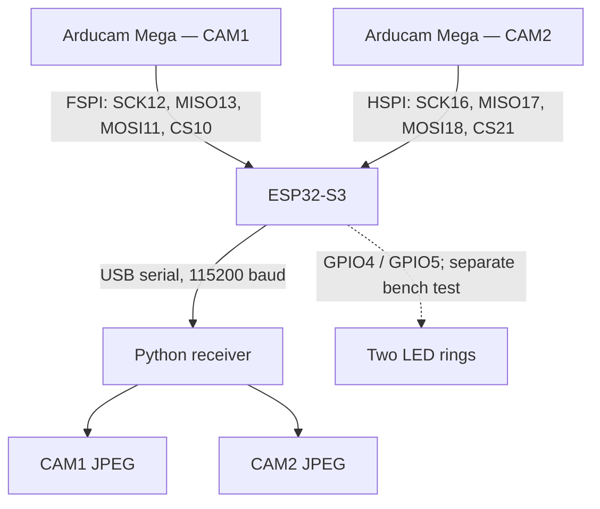
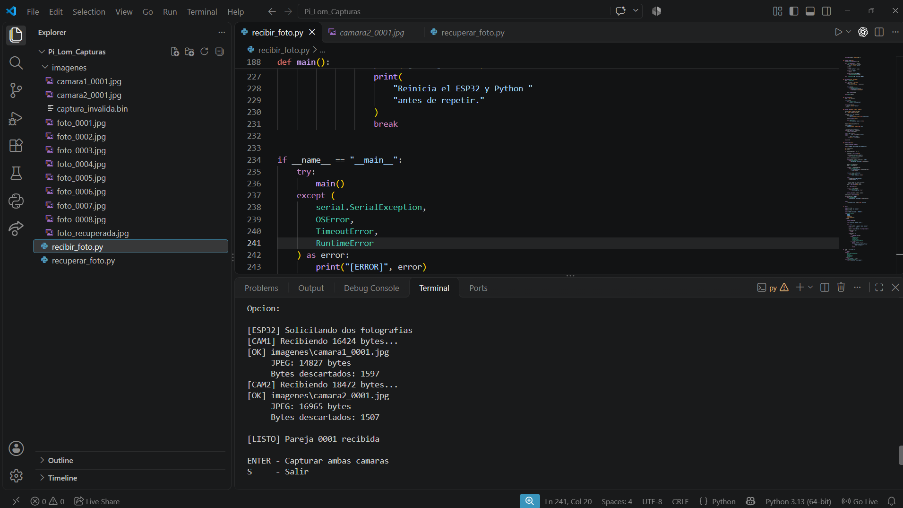
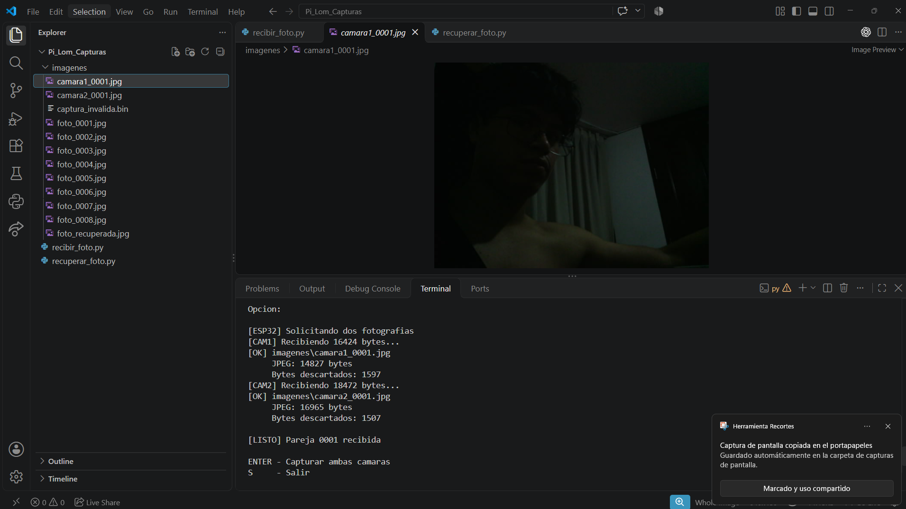
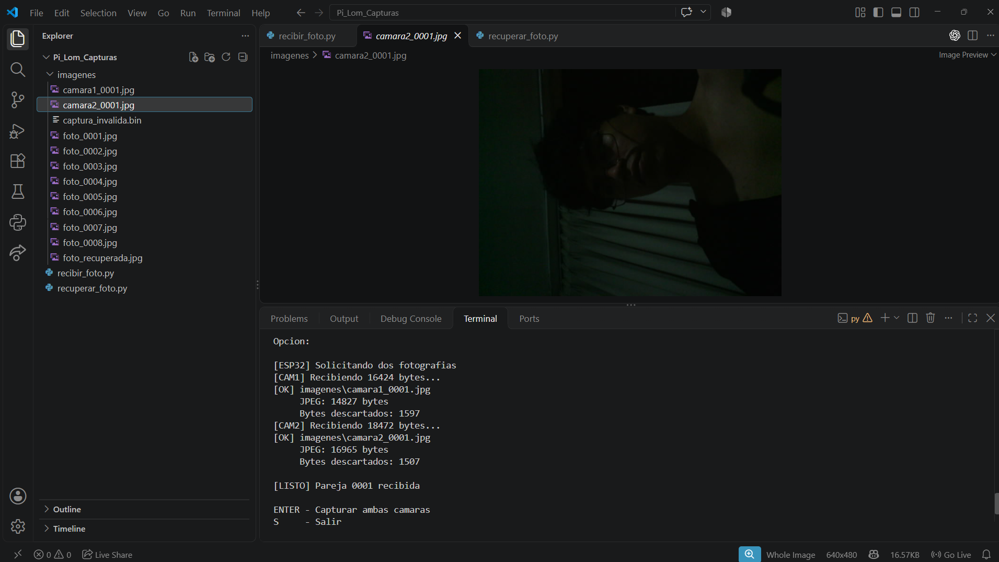

# ESP32-S3 Dual Camera System

**Two SPI cameras. One ESP32-S3. A documented path from initialization failures to a JPEG pair on a PC.**

Embedded imaging case study by **Joseph Lombardi Quispe**, developed within the LanternGuard team project at Universidad Peruana Cayetano Heredia (UPCH).



*Bench illumination test with two eight-pixel LED rings. This photograph demonstrates light output; it does not establish synchronization with camera exposure.*

This repository documents my work integrating two Arducam Mega cameras with a single ESP32-S3 controller: camera selection, SPI debugging, LED control and host-side JPEG reconstruction. It preserves the engineering evidence, the supplied Python receiver and an experimental library modification with a reviewable upstream diff.

**Current release status:** one JPEG pair was received over USB serial and opened on the PC. The author has now supplied the [USB capture sketch](firmware/dual_camera_usb_capture/dual_camera_usb_capture.ino). It implements sequential VGA JPEG capture from both cameras and the receiver’s serial protocol. The exact library snapshot deployed in the successful run is still unconfirmed; the archived FSPI/HSPI driver remains available for inspection. No firmware compilation or hardware rerun was performed for this publication.

[Hardware & wiring](docs/WIRING.md) · [Installation](docs/INSTALLATION.md) · [Library changes](docs/ARDUCAM_PATCH.md) · [Serial protocol](docs/SERIAL_PROTOCOL.md) · [Validation](docs/VALIDATION_STATUS.md) · [Evidence gallery](docs/EVIDENCE.md)

## Engineering focus

| Area | Work captured in this repository |
|---|---|
| Hardware integration | Two camera modules under one ESP32-S3, independent chip-select lines, provisional bench wiring |
| SPI driver investigation | Review of construction-time initialization, inactive CS states and an archived two-bus routing experiment |
| Embedded diagnostics | Before/after initialization logs, explicit per-camera status and separation of failures from successful runs |
| Illumination | Two WS2812B rings; documented bench operation and a clearly labeled reference sketch |
| Binary transport | Camera IDs, announced byte lengths, exact-length reads and end-of-frame checks over USB serial |
| Host tooling | Python JPEG extraction, pair numbering, exclusive file creation and error reporting |
| Experimental discipline | Original photographs, measured byte counts, source provenance and an explicit validation boundary |

## System architecture



The author confirms that the working arrangement uses **two independent SPI buses, each with its own SCK, MISO, MOSI and CS GPIOs**, on one ESP32-S3. The archived experiment implements FSPI for CAM1 and HSPI for CAM2. Its exact pin map is documented below; matching the newly supplied capture sketch and archived library to the exact build used in the recorded run remains pending. The log receives CAM1 before CAM2: **two images per request does not imply simultaneous exposure**. See the [wiring guide](docs/WIRING.md).

LanternGuard's intended field architecture adds an underwater enclosure, an inclinometer, a cable to a buoy and a LoRa uplink. Those additions are not validated as an integrated system by the evidence here.

## Bench results

The recorded request completed as `Pareja 0001 recibida`. Both images were opened in VS Code; their previews display 640 × 480, despite the camera modules being identified as 5 MP hardware.

| Reported value | CAM1 | CAM2 |
|---|---:|---:|
| Bytes received | 16,424 | 18,472 |
| JPEG bytes saved | 14,827 | 16,965 |
| Bytes outside saved JPEG | 1,597 | 1,507 |
| Output filename | `camara1_0001.jpg` | `camara2_0001.jpg` |



*Original terminal screenshot. Counts describe one documented pair, not a benchmark or success-rate study. Discarded bytes must not be interpreted as a packet-loss rate.*

| CAM1 preview | CAM2 preview |
|---|---|
|  |  |

*These are PNG screenshots of the saved JPEG previews, not the original camera JPEG files. Both are dark, and CAM2 has a different orientation. No underwater image-quality or biofouling detection result is claimed.*

## Source and validation status

| Artifact or behavior | Status |
|---|---|
| Both camera initialization statuses `0` | Observed in the supplied serial screenshot |
| One USB-serial JPEG pair, opened on PC | Observed in terminal and preview screenshots |
| Both LED rings illuminated | Observed in bench photograph |
| [Python receiver](python/recibir_foto.py) | Supplied by the project author in this session; formatting repaired, host tests included |
| [FSPI/HSPI source archive](firmware/experimental_dual_bus/README.md) | Preserved experimental source; not hardware validated or compiled here |
| [LED reference sketch](firmware/led_ring_demo/led_ring_demo.ino) | Example supplied in the ZIP; not the exact archived illumination-test firmware |
| [USB capture firmware](firmware/dual_camera_usb_capture/dual_camera_usb_capture.ino) | Supplied by the author after publication; statically reviewed, not compiled or rerun here |
| Exact library build used in the successful run | Still unconfirmed; archived FSPI/HSPI source is preserved |
| [Offline JPEG utility](python/jpeg_extract_reference.py) | Reference-only utility, separate from the authentic receiver |

The full [validation and recovery record](docs/VALIDATION_STATUS.md) explains what was checked. Host tests exercise synthetic serial data; they do not reproduce the hardware experiment. No compile success, endurance, energy consumption, simultaneous exposure or integrated dual-camera LoRa result is asserted.

## Hardware connections

| Signal | CAM1 (FSPI) | CAM2 (HSPI) |
|---|---:|---:|
| SCK | GPIO12 | GPIO16 |
| MISO | GPIO13 | GPIO17 |
| MOSI | GPIO11 | GPIO18 |
| CS | GPIO10 | GPIO21 |

The SPI GPIOs are independent for each camera. This map matches the corrected project notes and preserved experimental driver; confirm it against the final capture firmware before reproducing the successful run. LED ring data uses GPIO4 and GPIO5, with eight LEDs per ring.

Cameras were reported powered from 5 V with a common ground. The [wiring guide](docs/WIRING.md) records the independent SPI connections and unresolved electrical details. Power and ground connections do not imply shared SPI signal GPIOs.

## Getting started

1. Read the [source status](docs/VALIDATION_STATUS.md) and [installation guide](docs/INSTALLATION.md). Use `firmware/dual_camera_usb_capture/dual_camera_usb_capture.ino` for the author-supplied capture logic. The separate archived two-bus sketch only tests initialization.
2. To use the Python receiver, compile and upload the capture sketch with the matching Dual SPI library, configure `PUERTO` in `python/recibir_foto.py` and install its dependency:

   ```bash
   python -m venv .venv
   # Windows PowerShell
   .venv\Scripts\Activate.ps1
   # Linux/macOS alternative: source .venv/bin/activate
   python -m pip install -r requirements.txt
   python -m serial.tools.list_ports
   ```

3. **Close Arduino IDE completely before running Python. Also close Serial Monitor, Serial Plotter and every other program using the same port.** The receiver needs exclusive access to the serial port; otherwise opening `COM13` may fail with “Access denied” or “port busy.” Merely leaving an unused editor window open is not the underlying contention—the serial connection is—but closing the IDE avoids an active or reopened monitor.
4. Restart or reset the ESP32-S3 after the receiver opens the port if needed so it can receive `READY`, then run:

   ```bash
   python python/recibir_foto.py
   ```

5. Press **Enter** for a pair and **S** to exit. Images are written under `imagenes/` relative to the current working directory. After a protocol error, stop the receiver, reset the board and restart the receiver. Do not upload new firmware while Python holds the port.

Run the hardware-independent tests with:

```bash
python -m unittest discover -s tests -v
```

## Debugging decisions and lessons

- **Make initialization observable.** A log ending at `[CAM1] Inicializando` is not a success. A later screenshot explicitly reports both results as `0` and `AMBAS CAMARAS LISTAS`.
- **Inspect initialization lifecycle and CS state.** The archived patch defers SPI initialization from camera construction and keeps inactive CS lines high. Its routing code selects FSPI or HSPI according to the active CS. The diff records the exact changes available; it does not prove which change fixed the final independent-bus setup.
- **Drain the announced frame before parsing more text.** The receiver reads all `N` bytes, then expects `END <camera>`. Extracting only up to JPEG EOI from the serial port would leave trailing bytes to interfere with the next header.
- **Check image quality separately from transfer success.** A saved and viewable image confirms useful progress; darkness and orientation still require controlled lighting and mounting tests.
- **Preserve the boundary between evidence and source.** The capture sketch is now supplied, but a working screenshot does not identify the exact library build used on the board. Confirming that build and the board settings remains an open reproducibility task.

More detail: [debugging log](docs/DEBUGGING.md), [protocol limitations](docs/SERIAL_PROTOCOL.md), [test plan](docs/TEST_PLAN.md).

## Repository guide

| Path | Purpose |
|---|---|
| `firmware/dual_camera_usb_capture/` | Author-supplied two-camera VGA JPEG capture and USB serial commands |
| `firmware/experimental_dual_bus/` | Archived two-bus initialization experiment, source snapshot, MIT notice and upstream diff |
| `firmware/led_ring_demo/` | Reference-only dual-ring example |
| `python/recibir_foto.py` | Author-supplied serial receiver with normalized chat formatting |
| `python/jpeg_extract_reference.py` | Separate offline reference utility |
| `tests/` | Synthetic transport and JPEG-extraction tests |
| `docs/` | Wiring, setup, protocol, debugging, source recovery and evidence |
| `assets/` | Eight unaltered photographs/screenshots from the project package |

## Project context and credits

This portfolio focuses on Joseph Lombardi Quispe's embedded imaging integration work within **LanternGuard**, a **group university project** at UPCH. The larger project addresses inspection of scallop-culture lantern nets. Team members: María Antezana De la Cruz, Gabriela Santamaria Huaytan, Melissa Bustos Montañez, Joseph Lombardi Quispe and Yoichi Palacios Tanaka. The repository does not claim sole authorship of the complete LanternGuard system or of the Arducam driver.

The [university TRL4 record](https://github.com/Joseph-L-Q/PI_Equipo_02/tree/main/Proyecto_Integrador/Talleres/TRL4%20-%20LanternGuard) remains the group project's technical reference. This repository does not modify it. LoRa image experiments in [LoRaVision](https://github.com/Joseph-Lombardi/LoRaVision) belong to a separate configuration.

Arducam's original camera library is credited to **Arducam Technology co., Ltd.** Its MIT license and copyright notices are retained. Adafruit NeoPixel and pySerial are external dependencies, not original driver work. See [third-party attribution](docs/THIRD_PARTY.md) and [licensing scope](LICENSE.md).

## Next milestones

Confirm the exact deployed Dual SPI library and board settings for the supplied capture sketch; retain original JPEGs and serial dumps; investigate the bytes outside each JPEG; measure illumination and energy; repeat capture pairs with timestamps; then integrate inclination sensing and the buoy radio link. Underwater operation, autonomous solar power, storage application and biofouling/tear classification remain future integration work.
