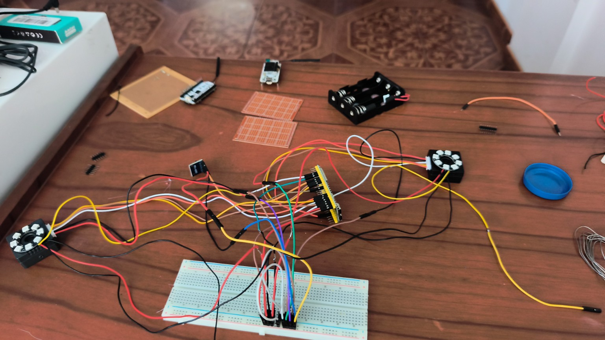
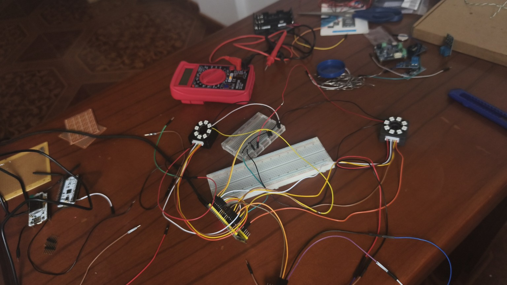
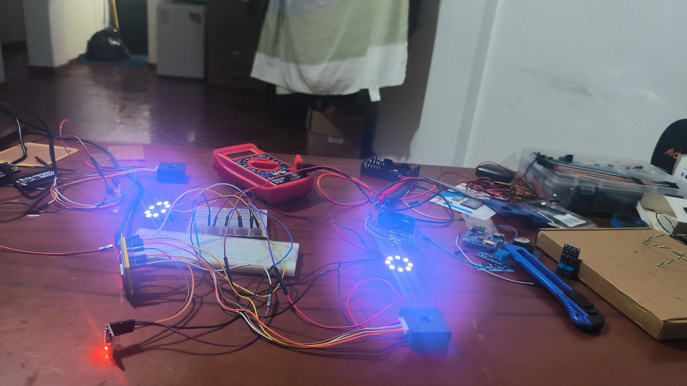
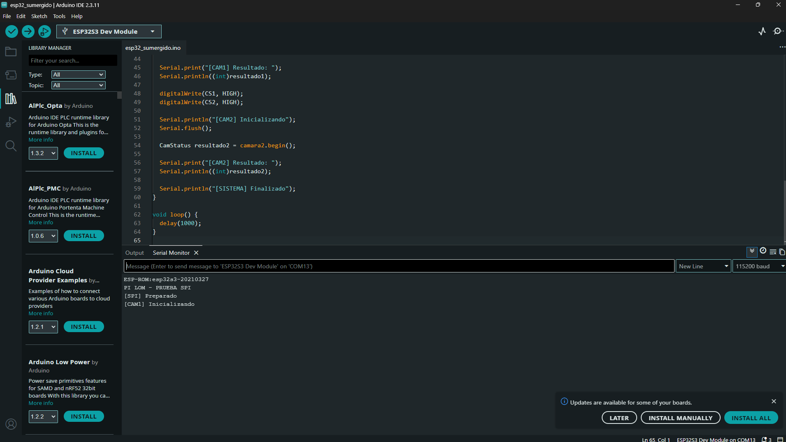
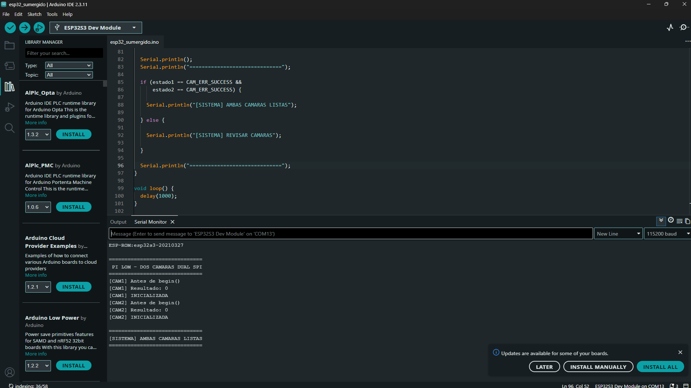
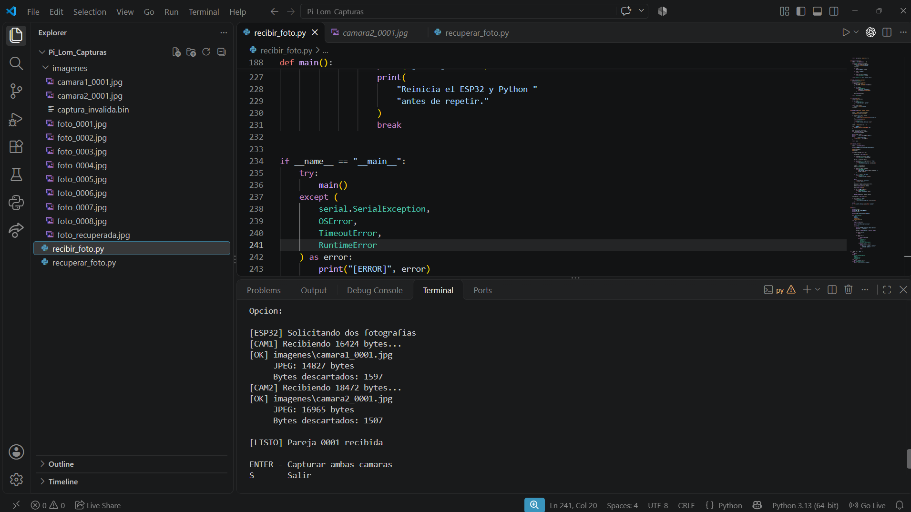
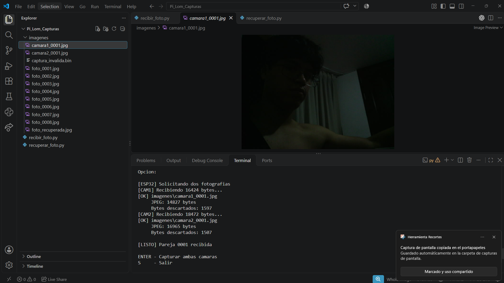
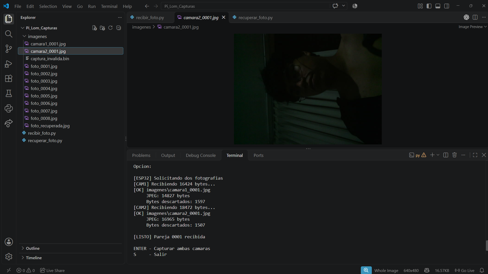

# Evidence gallery

[Back to project](../README.md)

Eight files are retained byte for byte from the author's portfolio package. File numbering is inherited from that package, not a measured chronological sequence. Individual capture timestamps were not archived. The TRL3 page screenshot was excluded as editorial context rather than experiment evidence.

## Physical bench assembly

*Figure 1. General assembly. Temporary wiring, no sealed or underwater installation.*

*Figure 2. Complementary assembly view. The photograph cannot certify each GPIO connection.*

*Figure 3. Two LED rings illuminated. No recorded current, illuminance, exposure synchronization or temperature.*

## Initialization diagnosis

*Figure 4. Despite its inherited filename, this screenshot shows only `[SPI] Preparado` and `[CAM1] Inicializando`; it does not show successful dual initialization.*

*Figure 5. Both statuses `0`, followed by `AMBAS CAMARAS LISTAS`. This is a separate observed run, not proof that a specific archived patch was deployed.*

## Reception and image inspection

*Figure 6. USB-serial reception: CAM1 16424 received / 14827 JPEG / 1597 discarded; CAM2 18472 / 16965 / 1507. One completed pair is visible.*

*Figure 7. PNG screenshot of a JPEG preview, not the original JPEG. Dark indoor scene, 640 × 480 shown by the viewer.*

*Figure 8. PNG screenshot of the second JPEG preview. Dark image and different orientation. No net-inspection target or field validation.*

## File integrity

[SHA256SUMS](../assets/SHA256SUMS) lists the eight image hashes for checking preservation of this evidence set. It does not validate the missing original camera JPEGs or certify the experiment itself.
