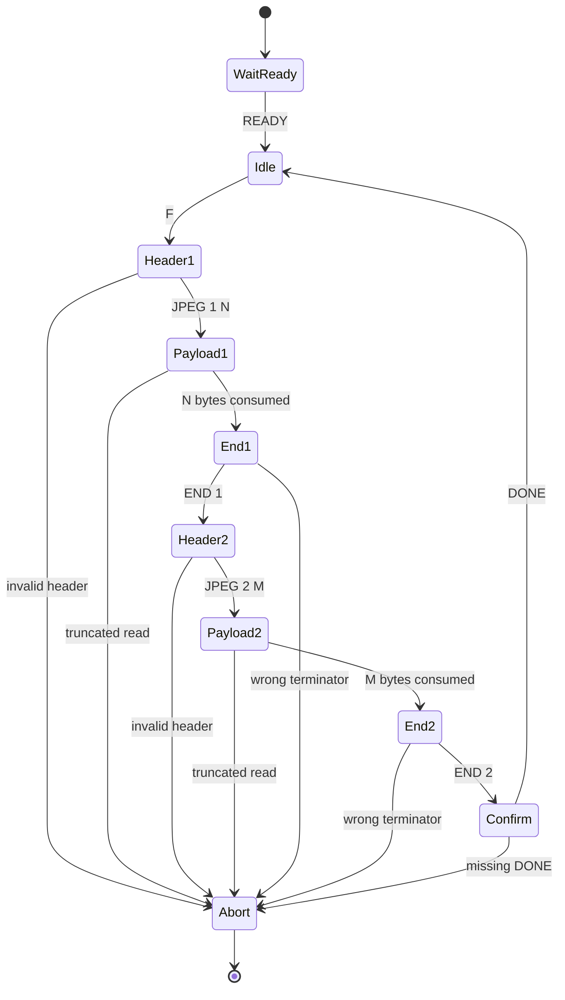

# USB serial protocol and receiver behavior

[Back to project](../README.md)

This specification is derived from the **author-supplied receiver**, not a recovered final firmware listing. Any replacement firmware must implement the same byte boundaries. The experimental initialization sketch does not implement this protocol.

## Wire contract

| Direction | Record | Receiver behavior |
|---|---|---|
| Board → PC, startup | ASCII line `READY` | Waits up to a nominal 30 seconds, printing other startup lines |
| PC → board | `F\n` | Requests one pair |
| Board → PC | ASCII line `JPEG 1 N` | Validates camera ID and `0 < N <= 2000000` |
| Board → PC | Exactly N binary bytes | Reads in chunks up to 4096 bytes; partial reads are accumulated |
| Board → PC | ASCII line `END 1` | Must be the next line after payload |
| Board → PC | ASCII line `JPEG 2 M` | Validates camera 2 and its announced length |
| Board → PC | Exactly M binary bytes | Consumes the complete payload |
| Board → PC | ASCII line `END 2` | Must match the camera |
| Board → PC | ASCII line `DONE` | Confirms the pair |

Each text record ends in LF; decoding strips surrounding whitespace, so CRLF text is accepted. The binary payload begins immediately after its header's line ending. **`END <id>` must begin immediately after the announced payload**, without a separate blank line between payload and END. For example, `...N payload bytes...END 1\n`. A separate newline there would be consumed as an empty line and rejected.

## JPEG extraction

`guardar_jpeg` finds the first SOI (`FF D8`) and last EOI (`FF D9`) in the already received block. It saves that slice and reports the remaining bytes as discarded. The receiver deliberately drains all announced bytes **before** reading `END`, preserving framing even when JPEG EOI occurs earlier in the payload.

This is marker-based extraction, not full JPEG decoding or a checksum. A marker pair can enclose malformed content. Multiple concatenated JPEGs or marker-like data require more validation than this script provides. The reported discarded byte counts do not identify their cause or measure radio loss.

If markers are missing, the raw block is saved as `camara<id>_<number>_invalida.bin`. Valid `.jpg` output uses exclusive creation (`xb`) to prevent overwriting. Pair numbering advances from the largest matching `camara1/2_<number>.jpg`; the regex was repaired from chat-format corruption. Invalid diagnostic `.bin` output retains the author's `write_bytes` behavior and may overwrite a same-named diagnostic. Only successfully decoded filenames influence the next number.

## Failure boundaries

- A wrong camera, header, length, terminator or confirmation aborts the capture. Firmware `ERROR...` lines are propagated at startup/header stages.
- The serial timeout is 15 seconds per blocking read; it is not a whole-frame deadline. `READY` uses a nominal 30-second monotonic loop but a blocking `readline` may extend the effective limit.
- There is no CRC, retransmission, frame identifier on the wire or automatic stream resynchronization.
- Files are saved per camera before the final `DONE`: a second-camera failure or missing `DONE` can leave a partial/unconfirmed pair on disk. `DONE` validates the transaction in the console, not an atomic storage commit.
- Startup messages may be missed if the board does not reset on port open; reset while waiting for `READY`.
- The routine accepts ordered sequential frames. It provides no evidence of simultaneous exposure.

These behaviors are documented rather than silently replaced in the author-supplied implementation. A later maintained receiver can add deadlines, integrity checks and atomic pair storage with a separate validation record.
