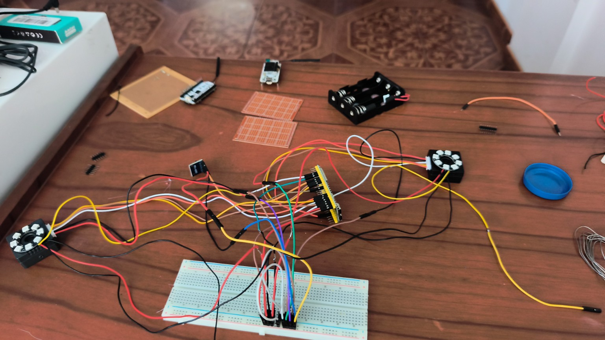
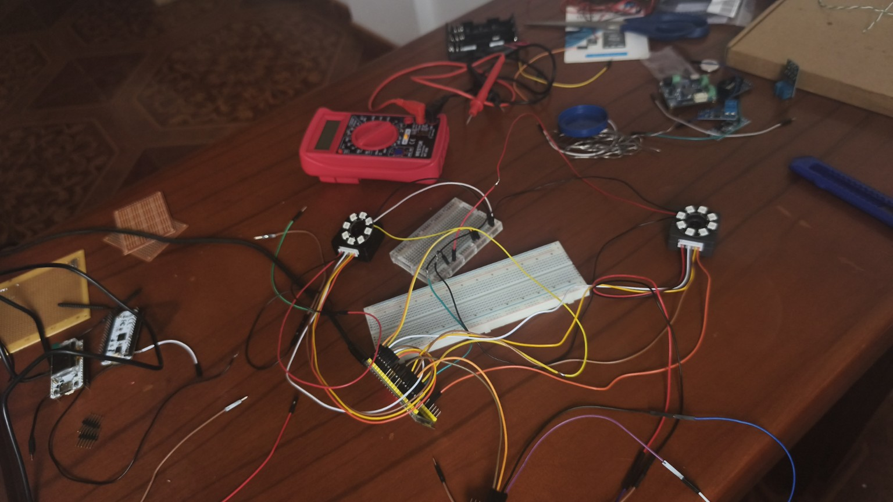

# Hardware and wiring

[Back to project](../README.md)

## Bench bill of materials

| Item | Quantity | Evidence / role |
|---|---:|---|
| ESP32-S3 Dev Module | 1 | Controller selected in Arduino IDE |
| Arducam Mega 5 MP modules | 2 | Per-camera initialization and image previews |
| WS2812B eight-pixel rings | 2 | Both illuminated in bench photograph |
| Protoboard, jumper wires, USB cable and PC | As required | Temporary bench connections and host reception |
| MPU6050 | Earlier subsystem test | Not part of a documented synchronized imaging run |

Camera module nominal resolution is not the resolution of this test: previews show 640 × 480. Component revisions, USB bridge type and power budget were not archived.

## Two configurations that must not be mixed

| Signal | Reported successful shared-SPI bench | Archived experimental FSPI/HSPI source |
|---|---|---|
| CAM1 SCK / MISO / MOSI | GPIO12 / GPIO13 / GPIO11 | GPIO12 / GPIO13 / GPIO11 |
| CAM1 CS | GPIO10 | GPIO10 |
| CAM2 SCK / MISO / MOSI | GPIO12 / GPIO13 / GPIO11 | GPIO16 / GPIO17 / GPIO18 |
| CAM2 CS | GPIO21 | GPIO21 |
| Ring 1 / ring 2 data | GPIO4 / GPIO5 reported | Reference LED sketch uses GPIO4 / GPIO5 separately |
| Source of mapping | Author's bench context and university TRL4 | Actual `ArducamSpi.cpp` in this archive |
| Reproduction status | Final firmware/library missing | Source retained; not compiled or hardware verified here |

In a shared-bus design, camera selection uses separate CS lines and only the selected device should drive the bus. This design intent does not prove the actual deployed driver's timing or final initialization sequence. The experimental driver holds both CS lines high, then selects a bus and lowers the requested CS. It is a single-active-camera implementation, not a concurrent transfer engine.

Cameras were reported powered from 5 V and shared ground. Ring supply wiring, level adaptation, current capacity, decoupling and cable lengths are not adequately recorded to publish a complete electrical schematic. Check the actual board and module documentation before wiring; the reported supply voltage does not imply 5 V tolerance of ESP32 GPIOs. Do not derive a power design from the photographs.

Earlier MPU6050 tests used SDA GPIO8 / SCL GPIO7 and reported I²C address 0x68. Do not confuse that sensor with the ultrasonic distance sensor in earlier telemetry tests. No accelerometer-driven capture decision is demonstrated in this release.

## Physical assembly

*Provisional dry bench arrangement, without a sealed enclosure.*

*Alternative view for physical context; wire colors are not a certified pin map.*

There is no documented immersion, pressure or marine endurance test for this electronic assembly. The university project's mechanical simulations must not be treated as physical leak testing.
